# Transformer-Based EV Charging Cyber Attack Detection
**AI-Powered Security Monitoring for Electric Vehicle (EV) Charging Infrastructure**

> **Academic Prototype Disclosure**: This cybersecurity prototype utilizes safe synthetic and simulated telemetry data to demonstrate the detection of four critical cyber-attack patterns against EV charging infrastructure. No real-world attacks or harmful malware are executed.

---

## 1. Project Overview

As Electric Vehicle Supply Equipment (EVSE) and smart charging grids expand rapidly, charging stations increasingly rely on network protocols such as **OCPP (Open Charge Point Protocol 1.6J / 2.0.1)** to communicate with cloud Central Systems (CSMS). These cyber-physical systems face emerging threats including network denial of service, telemetry tampering, credential stuffing, and controller firmware manipulation.

This project delivers a **Transformer-Based Cyber Attack Classifier** that:
- Monitors multi-modal EV telemetry (electrical measurements + network protocol traffic)
- Establishes a baseline of normal operating behavior
- Dynamically classifies four major cyber-attack patterns
- Extracts **Multi-Head Self-Attention weights** for explainable AI security triage
- Generates real-time **Intrusion Alerts** with dynamic severity and tactical mitigation recommendations

---

## 2. Attack Categories Detected

| Attack Category | Attack Indicators | Threat Level |
|---|---|---|
| **1. Denial of Service (DoS)** | Traffic rate surge (180–600 req/s), abnormal packet count (>20,000 pkts), response latency spike (>300ms) | **CRITICAL** |
| **2. Data Tampering** | Physical conservation violation ($P \neq V \times I$, energy skew), checksum/HMAC failure, data integrity score $< 0.70$ | **HIGH** |
| **3. Unauthorized Access** | Repeated authentication failures (`OCPP_Authorize`), unknown rogue IP/MAC identifier, brute-force stuffing | **HIGH / MEDIUM** |
| **4. Malware Activity** | Out-of-order command sequence, anomalous command frequency ($>45$ cmds/min), unexpected firmware/relay cycles | **CRITICAL** |
| **Normal Behavior** | Nominal AC/DC voltages, consistent power-energy integration, steady packet cadence, integrity $\ge 0.98$ | **NORMAL** |

---

## 3. End-to-End Pipeline Architecture

```mermaid
flowchart LR
    A[EV Charging Stations\nEV-CS-01 to 06] --> B[OCPP & Telemetry Data\nPackets & MeterValues]
    B --> C[Data Injection Engine\nSynthetic & CSV Upload]
    C --> D[Traffic Analysis\nRPS, Latency, Auth Fails]
    D --> E[Feature Extraction\n16 Cyber-Physical Features]
    E --> F[Transformer Classifier\nMulti-Head Self-Attention]
    F --> G[5-Class Prediction\nConfidence & Attention]
    G --> H[Intrusion Alert Engine\nSeverity & SOC Action]
    H --> I[Cybersecurity Dashboard\nReal-time SOC Interface]
```



### The 5 Main Stages:
1. **Data Injection**: Continuous telemetry ingestion supporting pre-generated synthetic datasets, live randomized simulation, single-step injection, and CSV upload.
2. **Traffic Analysis**: Real-time traffic rate (RPS), throughput volume, packet counts, and latency profiling.
3. **Feature Extraction**: Cyber-physical feature engineering capturing:
   - Voltage Deviation: $\Delta V = \frac{|V - V_{nom}|}{V_{nom}}$
   - Energy Consistency: $\Delta E = \frac{|P \cdot \frac{t}{60} - E_{meter}|}{E_{meter}}$
   - Composite Traffic Intensity Index: $T = \frac{\text{RPS}}{25} + \frac{\text{Latency}}{250} + \frac{\text{PacketRate}}{15}$
   - Authentication Failure Rate & Integrity Score
4. **Transformer Classifier**: PyTorch Tabular Transformer projecting continuous features into token embeddings, processing via Multi-Head Self-Attention layers, and computing a 5-class softmax posterior.
5. **Intrusion Alert Engine**: Produces actionable alerts containing Alert ID, affected station, confidence score, severity rating (LOW, MEDIUM, HIGH, CRITICAL), and domain-specific incident response actions.

---

## 4. AI Transformer Model Architecture

- **Framework**: PyTorch 2.14+
- **Input Dimension**: 16 engineered features
- **Embedding Dimension ($d_{model}$)**: 32
- **Attention Heads ($n_{head}$)**: 4
- **Encoder Layers**: 2 Transformer encoder layers with GELU activations and Layer Normalization
- **Self-Attention Explainability**: Direct extraction of attention weights from the `[CLS]` token to all 16 feature tokens, providing mathematical proof of which telemetry features triggered the alert.

### Prototype Evaluation Metrics (Synthetic Dataset)
*Disclosure: Evaluated on 4,000 synthetic multi-class samples (80% train / 20% stratified validation).*
- **Overall Accuracy**: **100.0%**
- **Macro Precision**: **100.0%**
- **Macro Recall**: **100.0%**
- **Macro F1-Score**: **100.0%**

---

## 5. Technology Stack

- **Backend**: Python 3.14+, FastAPI, Uvicorn, SQLite
- **AI/ML**: PyTorch 2.14+, Scikit-Learn, NumPy, Pandas
- **Frontend**: React 18, Tailwind CSS, Chart.js, Lucide Icons, JetBrains Mono typography

---

## 6. Quick Start Guide

### Step 1: Open Terminal in Project Directory
```powershell
cd C:\Users\N.YAMINI\.gemini\antigravity\scratch\ev_charging_transformer_defense
```

### Step 2: Launch the Master Server
```powershell
python run_server.py
```

### Step 3: Open the SOC Dashboard
- **Local Access**: Navigate to `http://127.0.0.1:8000` in any web browser.
- **Public Internet Access (Any Phone, Laptop, Tablet, or Network)**:
  Run `start_public_tunnel.bat` or use the active public HTTPS URL.

---

## 7. Faculty Demonstration Walkthrough

1. **Dashboard Home**: Show live network KPIs, active stations, dual-axis traffic/latency graph, and threat distribution donut.
2. **Station Infrastructure Map**: Click any station (e.g. `EV-CS-04`) to inspect active voltage, power, and threat status.
3. **Live Simulation Lab**:
   - Click **▶ START CONTINUOUS SIMULATION** to demonstrate automatic background traffic ingestion.
   - Click **🔴 DoS Simulation**: Observe the 5-stage pipeline light up in real-time, displaying a CRITICAL alert with 98%+ confidence.
   - Click **🟡 Data Tampering**: Observe the electrical energy mismatch alert.
   - Click **🟠 Unauthorized Access**: Observe credential stuffing interception.
   - Click **🟣 Malware Activity**: Observe out-of-order OCPP command interception.
4. **AI Transformer Model View**: Walk through the 5x5 confusion matrix, training loss curves, and the feature self-attention weights bar chart.
5. **Security Event Log**: Search, filter by severity, and click **Download CSV Audit Log** to export the incident trail.

